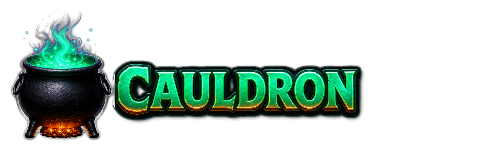
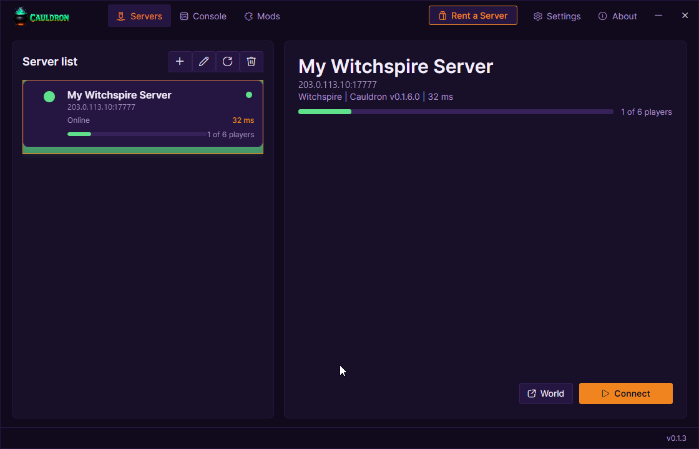

  <picture>
    <source media="(prefers-color-scheme: dark)" srcset="docs/img/cauldron-lockup-dark.png">
    
  </picture>

  
  
  
  

# Cauldron

Witchspire has no dedicated server. Its online co-op is hosted from one player's copy of the game. Cauldron adds a Witchspire dedicated server: [CauldronServer](https://github.com/HumanGenome/CauldronServer) runs the game headless on a Windows machine with a public IP and port, and the Cauldron app connects players to it by address.

Every player must install Cauldron to join a Cauldron server. Stock Witchspire cannot connect to a Cauldron server directly.

  

## Features

### 🧭 Join by address
Add the server's `ip:port` in the app and click Connect. The app puts its join mod into your game, starts Witchspire and joins the server once the menu has loaded. The server list shows whether each server is up, how many players are on it and your ping. A `cauldron://` link from a hosting panel adds a server in one click.

### 👻 No idle host character
The server's own character is hidden, so players never find a motionless witch standing at spawn. Every character in the world belongs to a player, and new players go through Witchspire's own character creation on their first join.

### 🔁 World backups
The app's World window takes a snapshot of the world, restores an earlier one, downloads a snapshot to your PC, imports a save from your own Witchspire, and copies the latest snapshot over from another of your servers. It uses the server's admin password.

### 🖥️ Console in the app
The Console tab connects to the server's RCON port with the admin password: server status, the player list and snapshots, without leaving the app.

### 📡 Server query
CauldronServer answers Source A2S with the server name, the map and the live player count, so server browsers, monitoring tools and bots can read it.

### 🧩 Host mods
The host runs the `cauldron_host` AngelScript mod, which opens the world for players, saves it on a timer and hides the host's own character. Other AngelScript mods in the host's `Hercules\Script\Mods` folder load with it; one that fails to compile stops the world from loading.

### 🔄 Plain game afterwards
Starting Witchspire from Steam runs the normal game. From v0.1.16 the app takes its join mod and network settings back out when the game closes. The app updates itself, and every update is signed.

## Install

### Managed hosting
[SurvivalServers.com Witchspire server hosting](https://www.survivalservers.com/services/game_servers/witchspire/?utm_source=github&utm_medium=readme_install&utm_campaign=cauldron) comes with Cauldron installed and the ports open. The control panel has an Open in Cauldron button that adds the server to the app.

### Players
1. Download `CauldronSetup-latest.exe` from the [latest release](https://github.com/HumanGenome/Cauldron/releases/latest/download/CauldronSetup-latest.exe).
2. Run it. Windows SmartScreen may warn because the installer is not code-signed yet; choose **More info**, then **Run anyway**.
3. Open Cauldron, add the server address, click Connect.

### Self-hosted servers
The supervisor, its ports and the RCON commands are in [CauldronServer](https://github.com/HumanGenome/CauldronServer). Self-hosting is not turnkey yet: the server package does not put the host mod into your Witchspire install or set its port, so a server started from it alone opens no world. CauldronServer's README lists what it leaves out. You need a Windows machine and Witchspire's game files on it from your own Steam copy.

## Releases

This repo publishes the player side: `CauldronSetup-<version>.exe`, a `CauldronSetup-latest.exe` alias, the portable `Cauldron-Launcher-Windows-x64-v<version>.zip` and `checksums-launcher.txt`. The server package is on the [CauldronServer release page](https://github.com/HumanGenome/CauldronServer/releases/latest), with its [changelog](https://github.com/HumanGenome/CauldronServer/blob/main/CHANGELOG.md). Both repos share one version line.

## Source

- **Cauldron** (this repo): the app players install, the downloads and the documentation.
- **[CauldronServer](https://github.com/HumanGenome/CauldronServer)**: the server supervisor hosts run next to Witchspire's game files, open source.

## FAQ

### Does everyone need the app?
Yes. The game cannot reach a Cauldron server without it.

### Does it change my game?
While you play on a Cauldron server, the app adds a small join mod under Witchspire's `Hercules\Script\Mods\Cauldron` folder and its network settings to Witchspire's `Engine.ini` in `%LOCALAPPDATA%\Hercules`. From v0.1.16 it removes both when the game closes and puts back an `Engine.ini` you already had. It also turns DLSS and frame generation off in Witchspire's graphics settings, because they crashed the game in a Cauldron world; switch them back on in the game for normal play.

### Where is my character saved?
On the server, with the world.

### Can a world move between servers?
Yes. Download a snapshot from one server in the World window and import it on the other, or copy the latest snapshot over directly.

### Is Linux supported?
No. The app and the server are Windows only.

### Is this official?
No. Cauldron is an independent project. Envar Games does not ship dedicated servers for Witchspire.

### Something broke
[Open an issue](https://github.com/HumanGenome/Cauldron/issues). If you rent a server, your host handles billing and control panel questions.

## Contributing

See [CONTRIBUTING.md](CONTRIBUTING.md). Security issues go through [private reporting](https://github.com/HumanGenome/Cauldron/security/advisories/new), never a public issue.

## Community note

Cauldron is an independent community project. It is not affiliated with, endorsed by, or supported by Envar Games.

## License

MIT, see [LICENSE](LICENSE).

## Credits

- [Avalonia](https://avaloniaui.net/), the .NET UI framework the app is built with
