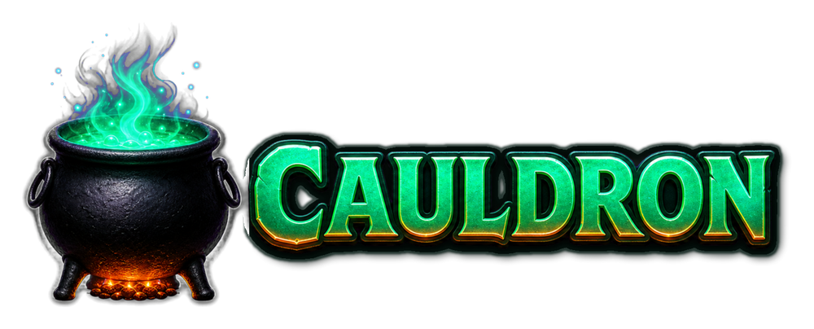
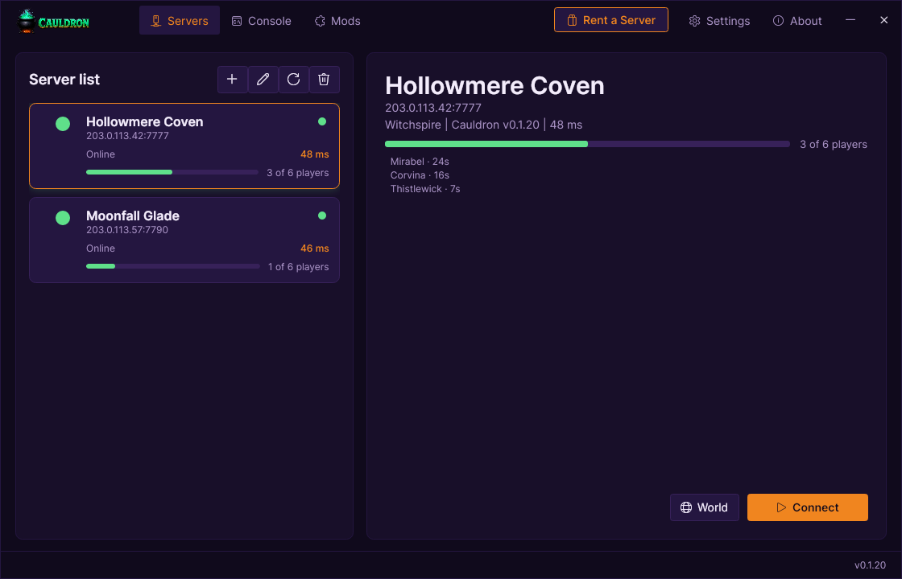
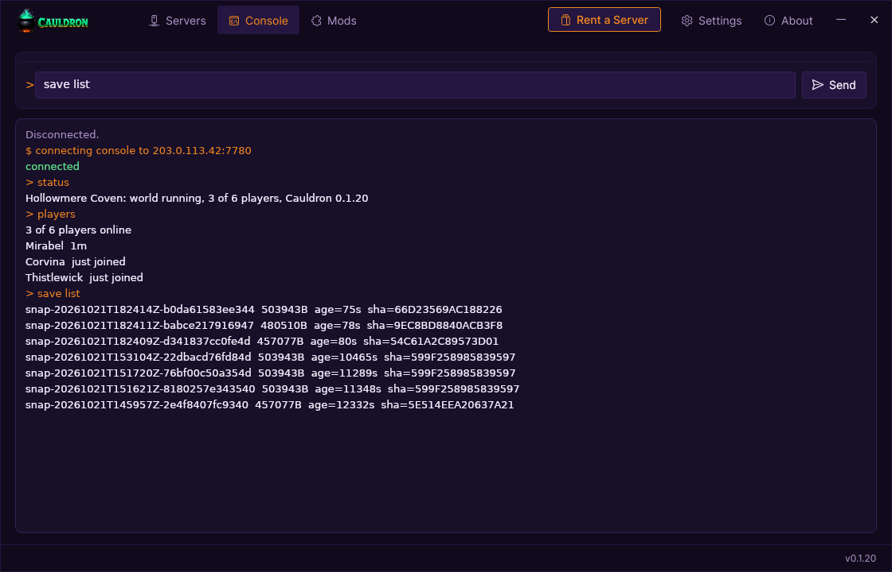
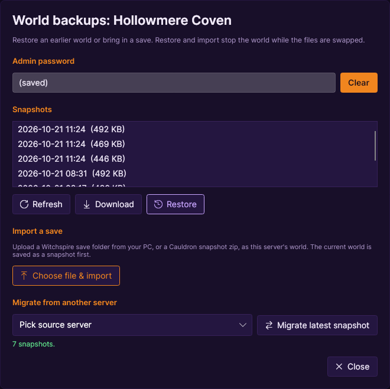

  <picture>
    <source media="(prefers-color-scheme: dark)" srcset="docs/img/cauldron-logo-dark.png">
    
  </picture>

  
  
  
  
  

# Cauldron

Witchspire has no dedicated server. Its online co-op is hosted from one player's copy of the game. Cauldron adds a Witchspire dedicated server. Players join it by IP with the Cauldron app.

Every player needs the Cauldron app to join.

## Features

### 🧭 Join by IP
Add the server's IP and port once, then click Connect. Cauldron starts Witchspire and joins the server as soon as the main menu loads. Your server list shows if each server is online, how many players are on it and your ping, and refreshes every 30 seconds. A host's Open in Cauldron button adds the server in one click.

  

### 🖥️ Server console
The Console tab runs RCON commands with the server's admin password: check the server, see who's on and for how long, and make or list world backups.

  

### 💾 World backups
Click World to download a backup, restore an earlier world, upload a Witchspire save from your PC, or copy the latest backup from another of your servers. The server backs up the world that was running first, then restarts with the new one. A CauldronServer you run yourself also backs up the world when Witchspire saves, at most once every 15 minutes, and keeps each backup for 30 days.

  

### 💬 In-game chat
Press T to talk to everyone on the server. Needs CauldronServer 0.1.22 or newer.

## Install

### Rent a server
[SurvivalServers.com](https://www.survivalservers.com/services/game_servers/witchspire/?utm_source=github&utm_medium=readme_install&utm_campaign=cauldron) runs Witchspire servers with CauldronServer installed. In Command Center, Open in Cauldron adds the server to your server list.

### Players
1. Download `CauldronSetup-latest.exe` from the [latest release](https://github.com/HumanGenome/Cauldron/releases/latest/download/CauldronSetup-latest.exe).
2. Run it. If Windows shows "Windows protected your PC", choose **More info**, then **Run anyway**.
3. Open Cauldron, add the server's IP and port, and click Connect.

### Host your own
Run the server on your own Windows PC with [the server download](https://github.com/HumanGenome/CauldronServer/releases/latest) and a copy of Witchspire from your own Steam account. It shows up in server lists and takes RCON commands. The [setup steps](https://github.com/HumanGenome/CauldronServer#host-your-own), ports and commands are in CauldronServer's README.

## Releases

Each release here has `CauldronSetup-<version>.exe`, `CauldronSetup-latest.exe`, the portable `Cauldron-Launcher-Windows-x64-v<version>.zip` and `checksums-launcher.txt`. The server download is on the [CauldronServer release page](https://github.com/HumanGenome/CauldronServer/releases/latest), with its [changelog](https://github.com/HumanGenome/CauldronServer/blob/main/CHANGELOG.md). Both repos use the same version numbers.

## Source

- **Cauldron** (this repo): the app players install, the downloads and the documentation.
- **[CauldronServer](https://github.com/HumanGenome/CauldronServer)**: the dedicated server, open source.

## FAQ

### How many players can join?
Up to 6. Witchspire is made for 1 to 6 players, in Envar Games' own words on its [Steam page](https://store.steampowered.com/app/2679100/), and a Cauldron server has had 6 players in one world at once. The server's hidden host doesn't take a place. The server owner sets how many players can join.

### Is there a host character standing in the world?
No. The server's own character is hidden, so every witch you meet in the world is a player.

### Does it change my game?
While you play on a Cauldron server, the app adds a small join mod under Witchspire's `Hercules\Script\Mods\Cauldron` folder and its network settings to Witchspire's `Engine.ini` in `%LOCALAPPDATA%\Hercules`. It removes both when the game closes and puts back an `Engine.ini` you already had, so starting Witchspire from Steam runs the normal game. It also turns DLSS and frame generation off in Witchspire's graphics settings, because they crashed the game in a Cauldron world; switch them back on in the game for normal play.

### Where is my character saved?
On the server, with the world.

### Can a world move between servers?
Yes. In the app's World window on the new server, pick the old one under **Migrate from another server** and click **Migrate latest snapshot**. By hand: stop both servers and copy the world's `Saved\SaveGames` folder from one to the other.

### Does the app update itself?
Yes. It downloads new versions in the background and installs them by itself. Every update is signed, and the app won't install one that isn't.

### Is Linux supported?
No. The app and the server are Windows only.

## Contributing

See [CONTRIBUTING.md](CONTRIBUTING.md). Security issues go through [private reporting](https://github.com/HumanGenome/Cauldron/security/advisories/new), never a public issue.

Bugs: [open an issue](https://github.com/HumanGenome/Cauldron/issues).

## Community note

Cauldron is an independent community project. It is not affiliated with, endorsed by, or supported by Envar Games.

## License

MIT, see [LICENSE](LICENSE).

## Credits

- [Avalonia](https://avaloniaui.net/), the .NET UI framework the app is built with
