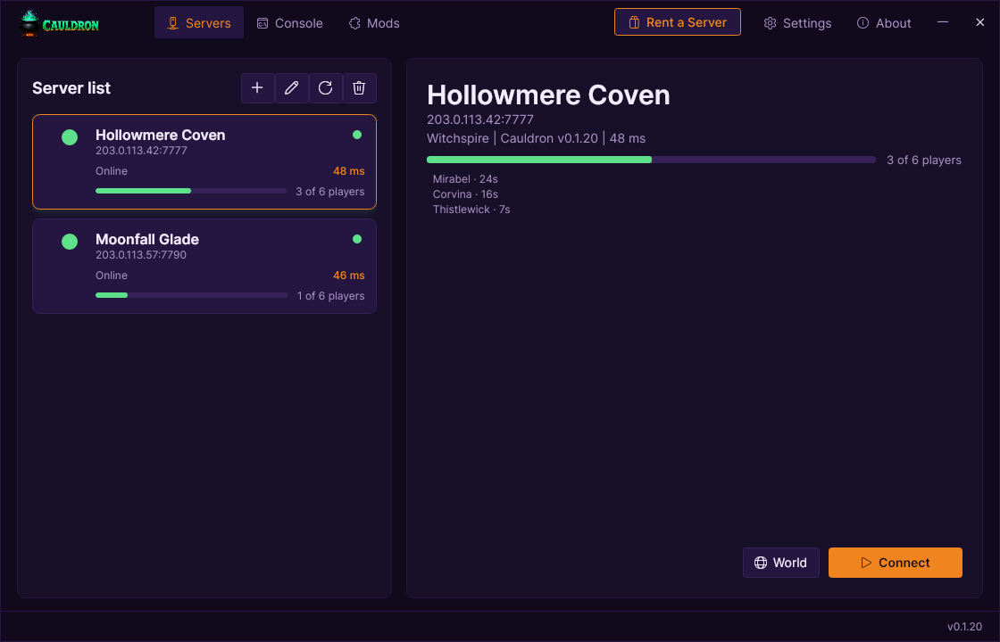
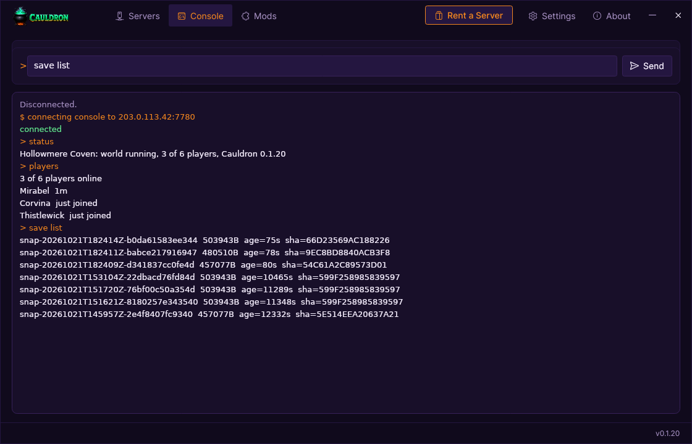
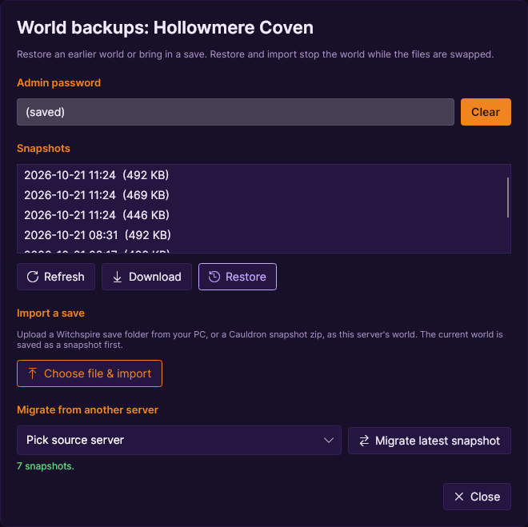

  <picture>
    <source media="(prefers-color-scheme: dark)" srcset="docs/img/cauldron-logo-dark.png">
    
  </picture>

  
  
  
  
  

# Cauldron

Witchspire has no dedicated server. Its online co-op is hosted from one player's copy of the game. Cauldron adds a Witchspire dedicated server: [CauldronServer](https://github.com/HumanGenome/CauldronServer) runs the game headless on a Windows machine with a public IP and port, and the Cauldron app connects players to it by address.

Every player must install Cauldron to join a Cauldron server. Stock Witchspire cannot connect to a Cauldron server directly.

## Features

### 🧭 Join by IP
Type the server's IP and port into the app once, then click Connect. The app puts its small join mod into your game, starts Witchspire and joins the server as soon as the main menu has loaded. Each saved server shows whether it is online, who is on it and your ping, and the list refreshes every 30 seconds. A `cauldron://` link from your host's control panel adds a server in one click.

  

### 🖥️ Admin console
The Console tab connects to the server's RCON port with its admin password: check the server, see who is on and for how long, and take or list world snapshots without leaving the app.

  

### 💾 World backups
The app's World window lists the server's snapshots, downloads one, restores an earlier world, uploads a Witchspire save from your PC, or brings the latest snapshot over from another of your servers. Restore and import stop the world while the files are swapped, and the world that was running is kept as a snapshot first. A self-hosted CauldronServer also snapshots the world by itself when Witchspire saves, at most once every 15 minutes, and keeps each snapshot for 30 days.

  

### 💬 In-game chat
In-game chat: press T to talk to everyone on the server. Needs a server running CauldronServer 0.1.22 or newer.

## Install

### Rent a server
[SurvivalServers.com Witchspire server hosting](https://www.survivalservers.com/services/game_servers/witchspire/?utm_source=github&utm_medium=readme_install&utm_campaign=cauldron) comes with Cauldron installed and the ports open. The control panel has an Open in Cauldron button that adds the server to the app.

### Players
1. Download `CauldronSetup-latest.exe` from the [latest release](https://github.com/HumanGenome/Cauldron/releases/latest/download/CauldronSetup-latest.exe).
2. Run it. The installer is not code-signed, so Windows SmartScreen may warn; choose **More info**, then **Run anyway**.
3. Open Cauldron, add the server's IP and port, and click Connect.

### Self-hosted servers
Run the server on your own Windows machine with the package from [CauldronServer](https://github.com/HumanGenome/CauldronServer/releases/latest) (v0.1.17 or later) and Witchspire's game files from your own Steam copy. CauldronServer answers Source RCON and A2S queries, so server browsers, monitoring tools and bots can read the server's name and player count. The [setup steps](https://github.com/HumanGenome/CauldronServer#self-hosting), ports and RCON commands are in CauldronServer's README.

## Releases

This repo publishes the player side: `CauldronSetup-<version>.exe`, a `CauldronSetup-latest.exe` alias, the portable `Cauldron-Launcher-Windows-x64-v<version>.zip` and `checksums-launcher.txt`. The server package is on the [CauldronServer release page](https://github.com/HumanGenome/CauldronServer/releases/latest), with its [changelog](https://github.com/HumanGenome/CauldronServer/blob/main/CHANGELOG.md). Both repos share one version line.

## Source

- **Cauldron** (this repo): the app players install, the downloads and the documentation.
- **[CauldronServer](https://github.com/HumanGenome/CauldronServer)**: the server supervisor hosts run next to Witchspire's game files, open source.

## FAQ

### Does everyone need the app?
Yes. Witchspire on its own cannot connect to a Cauldron server, so every player installs the app first.

### How many players can join?
Up to six. Witchspire is made for one to six players, in Envar Games' own words on its [Steam page](https://store.steampowered.com/app/2679100/), and a Cauldron server has had six players in one world at once; the server's own hidden host does not take a place. The host sets the server's slot count.

### Is there a host character standing in the world?
No. The server's own character is hidden, so every witch you meet in the world is a player.

### Does it change my game?
While you play on a Cauldron server, the app adds a small join mod under Witchspire's `Hercules\Script\Mods\Cauldron` folder and its network settings to Witchspire's `Engine.ini` in `%LOCALAPPDATA%\Hercules`. It removes both when the game closes and puts back an `Engine.ini` you already had, so starting Witchspire from Steam runs the normal game. It also turns DLSS and frame generation off in Witchspire's graphics settings, because they crashed the game in a Cauldron world; switch them back on in the game for normal play.

### Where is my character saved?
On the server, with the world.

### Can a world move between servers?
Yes. In the app's World window on the new server, pick the old one under **Migrate from another server** and click **Migrate latest snapshot**. By hand: stop both servers and copy the world's `Saved\SaveGames` folder from one to the other.

### Does the app update itself?
Yes. It downloads new versions in the background and installs them by itself. Every update is signed, and the app refuses one that is not.

### Is Linux supported?
No. The app and the server are Windows only.

### Is this official?
No. Cauldron is an independent project. Envar Games does not ship dedicated servers for Witchspire.

### Something broke
[Open an issue](https://github.com/HumanGenome/Cauldron/issues). If you rent a server, your host handles billing and control panel questions.

## Contributing

See [CONTRIBUTING.md](CONTRIBUTING.md). Security issues go through [private reporting](https://github.com/HumanGenome/Cauldron/security/advisories/new), never a public issue.

## Community note

Cauldron is an independent community project. It is not affiliated with, endorsed by, or supported by Envar Games.

## License

MIT, see [LICENSE](LICENSE).

## Credits

- [Avalonia](https://avaloniaui.net/), the .NET UI framework the app is built with
